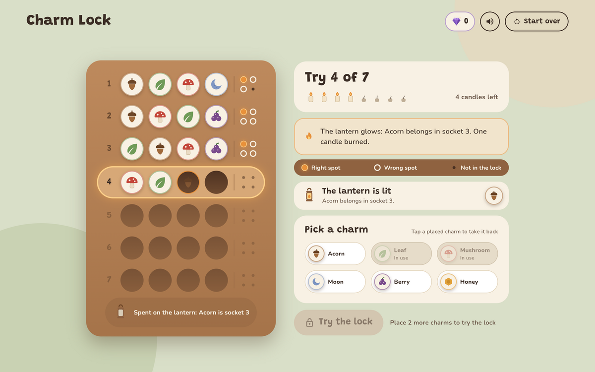
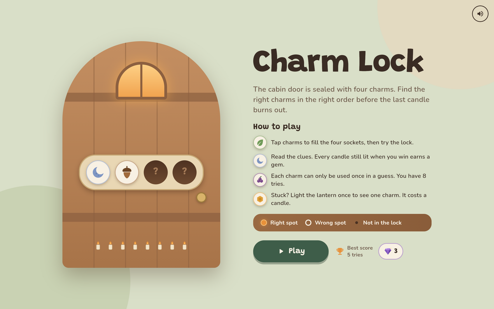
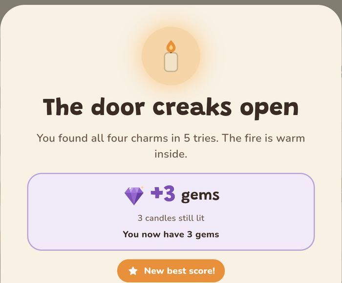
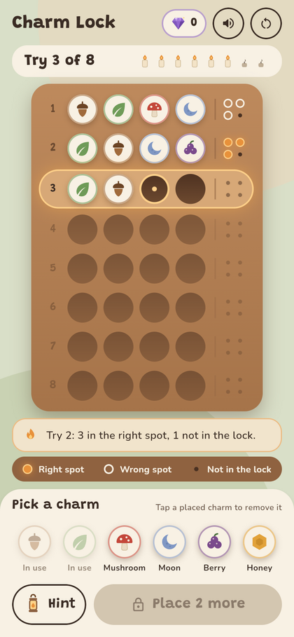

# Charm Lock

A cozy code-breaking puzzle game built with **Flutter** for the web.
The cabin door is sealed with four charms. Find the right charms in the right order before the last candle burns out.

**[▶ Play it live](https://charmlock.nour.sgubproject.com/)**



<p>
  
  
  
</p>

## Highlights

- **Clean separation of logic and UI.** All game rules live in one plain Dart class with no Flutter imports, covered by unit tests.
- **Single source of state.** One `StatefulWidget` owns the game; every other widget is stateless and redraws from it via `setState()`.
- **Responsive.** Three layouts (desktop, phone upright, phone sideways) chosen with `LayoutBuilder`. Everything fits on one screen with no scrolling.
- **Reward loop from user testing.** Gems and a persistent best score were added after a usability test showed winning didn't feel rewarding.
- **Polish.** Music and sound effects with a remembered mute toggle, subtle implicit animations that respect the system's reduce-motion setting.
- **No backend.** Progress is saved in the browser. Deployed as a static site on AWS S3 + CloudFront.

## How to play

- The lock hides a code of **4 different charms** picked from 6: acorn, leaf, mushroom, moon, berry, honey.
- Place 4 charms and press **Try the lock**. You have **8 tries**, shown as candles.
- Each try gets clues:
  - **Ember** (glowing dot): right charm, right spot
  - **Ring** (hollow circle): right charm, wrong spot
  - **Ash** (small dot): charm not in the lock
- **Lantern:** once per game, reveal one charm in its correct spot. It costs one candle.
- **Win** by finding the code. Every candle still lit earns a **gem**, plus 2 bonus gems if you never used the lantern.
- **Lose** when the last candle goes out. The code is revealed and you can play again.

## Run it locally

Requires the [Flutter SDK](https://docs.flutter.dev/get-started/install) (Dart 3.3+).

```bash
flutter pub get
flutter run -d chrome --web-port 8080   # fixed port keeps saved progress between runs
flutter test                            # run the game-rule tests
```

Build for production:

```bash
flutter build web --release             # output in build/web
```

`deploy.ps1` builds the app, syncs `build/web` to an S3 bucket and invalidates the CloudFront cache.

## Architecture

```
lib/
├── main.dart                  App entry: theme, loads saved settings
├── theme.dart                 Colors and text styles
├── game/
│   └── charm_lock_game.dart   Game rules (pure Dart, no UI)
├── screens/
│   ├── start_screen.dart      Title, rules, best score, Play
│   └── game_screen.dart       Owns the game state, calls setState()
├── widgets/                   Stateless UI: board, panels, dialogs, artwork
└── services/                  Sound, best score and gem persistence
test/
└── widget_test.dart           Unit tests for the rules
```

**Data flow.** `GameScreen` holds a `CharmLockGame` and the current message. It passes the game down to stateless widgets (`LockBoard`, `StatusPanel`, `CharmPicker`, …) and passes callbacks such as `onPick` for taps. A tap calls back into `GameScreen`, which updates the game inside `setState()`, and Flutter rebuilds the UI from the new state.

**Scoring.** `scoreGuess()` runs in two passes. The first counts exact matches (embers) and sets the unmatched charms aside. The second counts leftover guessed charms that appear among the leftover secret charms (rings). Each one is crossed off so it is never counted twice.

## Built with

- [Flutter](https://flutter.dev) & Dart
- [flutter_svg](https://pub.dev/packages/flutter_svg): vector artwork for the charms, candles and lantern
- [audioplayers](https://pub.dev/packages/audioplayers): music and sound effects
- [shared_preferences](https://pub.dev/packages/shared_preferences): saving best score, gems and settings
- Fonts: [Grandstander](https://fonts.google.com/specimen/Grandstander) and [Nunito](https://fonts.google.com/specimen/Nunito) (SIL Open Font License, bundled in `assets/fonts`)
- AWS S3, CloudFront and Route 53 for hosting

## Credits

Design, code and testing by **Nour Mhanna**. Artwork is drawn in code (SVG). Music and sound effects were synthesized for this project.
AI assistance: Claude (Anthropic) helped with ideas, code and documentation; all of it was reviewed, tested and adapted by me.

## License

Code released under the [MIT License](LICENSE). Fonts are under the SIL Open Font License.
